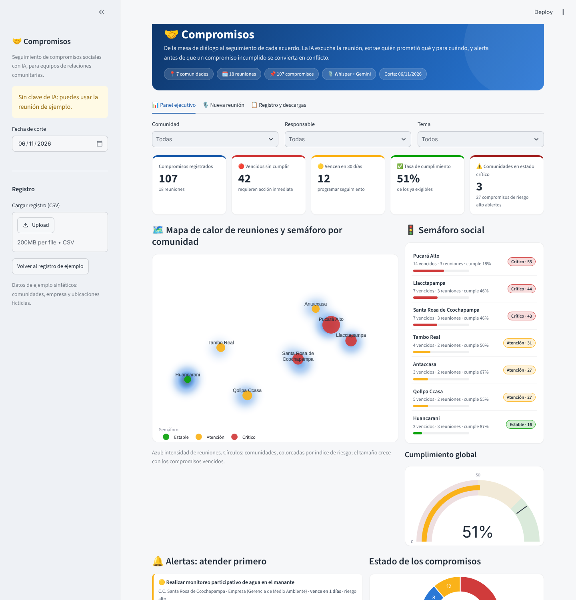
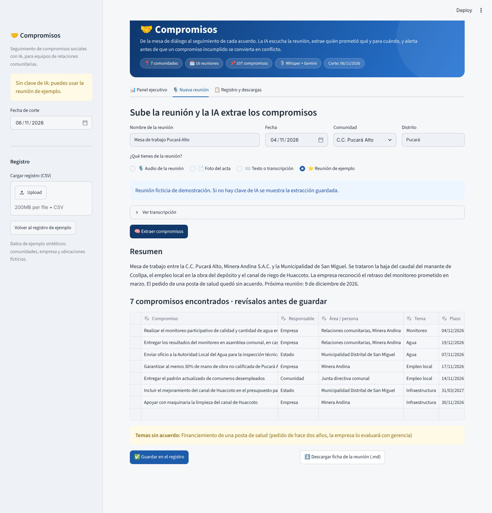
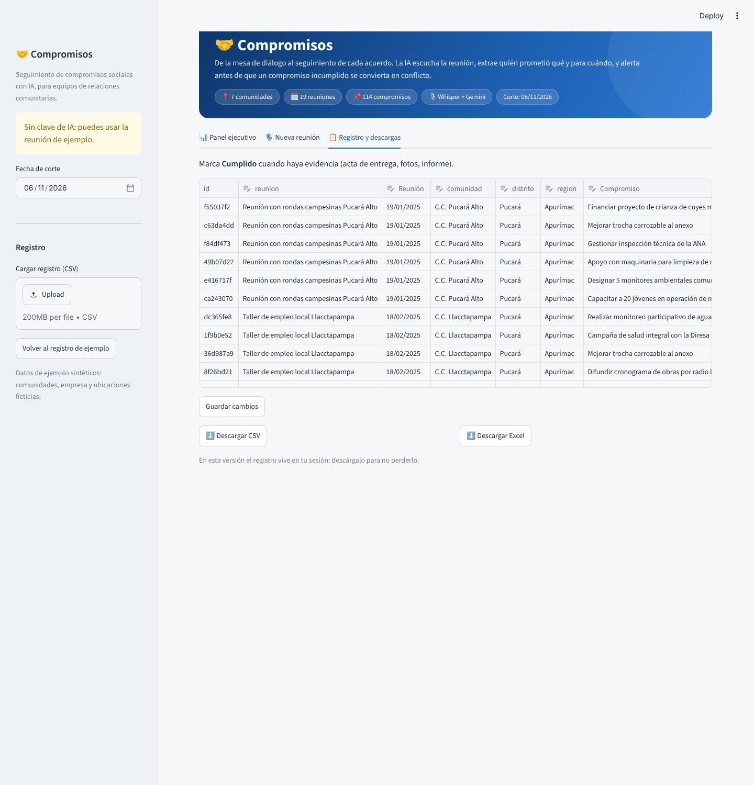

# 🤝 Compromisos


*Un producto de [Confluentia](https://www.confluentia.pe) · Inteligencia social para decisiones estratégicas en territorio.*

**Demo:** https://compromisos-roddy.streamlit.app · **Video de respaldo:** _pendiente_

> Proyecto final de la Diplomatura Q-Lab PUCP · Data Science con Python ([issue #204](https://github.com/d2cml-ai/Data-Science-Python/issues/204)).

## 1. One-liner

**Hacemos el seguimiento de los compromisos sociales para los equipos de relaciones comunitarias de minería, hidrocarburos y energía, mediante IA que transcribe cada reunión con la comunidad y convierte lo prometido en un registro con plazos y alertas.**

## 2. Founder

**Roddy Huarhua.** Historiador, con dos tesis sobre conflictos socioambientales en el Perú. Trabajo en relaciones comunitarias para empresas privadas y dirijo la consultora [Confluentia](https://www.confluentia.pe). Portafolio: [roddyhuarhua-hub.github.io](https://roddyhuarhua-hub.github.io).

He estado en las mesas donde se firman los compromisos y he visto qué pasa después: el acta queda en un archivador, el Excel lo actualiza una sola persona, y cuando esa persona rota, nadie sabe qué se prometió. Conozco el vocabulario (ANA, monitoreo participativo, padrón comunal, presupuesto participativo) y tengo acceso directo a los usuarios.

## 3. Problema

**Quién lo sufre.** Los equipos de relaciones comunitarias (relacionistas de campo y jefes de asuntos sociales) de empresas extractivas y de energía, y las consultoras que los apoyan. Del otro lado, las comunidades que esperan que se cumpla lo pactado.

**Qué cuesta.** Un compromiso incumplido u olvidado (un monitoreo de agua, un porcentaje de empleo local) es uno de los detonantes más frecuentes de la reactivación de conflictos que reporta mensualmente la Defensoría del Pueblo (ver mi [dashboard de conflictos sociales](https://roddyhuarhua-hub.github.io/Data-Science-Python/)). Un día de paralización de una operación cuesta mucho más que todo el sistema de seguimiento de un año. Además, el relacionista pierde horas pasando la reunión al acta y al Excel, y la gerencia recibe el estado de los compromisos tarde y a mano.

**Cómo se resuelve hoy.** Cuaderno de campo, acta manuscrita firmada, un Excel compartido y la memoria de las personas. Algunos usan software de gestión de stakeholders (genérico, caro, en inglés) que igual exige tipear todo a mano.

**Evidencia de usuarios.** Notas de 3 conversaciones en [`docs/research/`](docs/research/):

| # | Perfil | Lo que más aprendí |
|---|---|---|
| 1 | [Gerente de relaciones comunitarias, minera con operación y exploración](docs/research/entrevista_1.md) | Un tablero histórico "no es novedad": lo que vale es anticipar ("si haces esto, pasa esto"), entender el interés de fondo de cada actor y ahorrar las 2 a 3 horas semanales de consolidar Excel. Los procesos se frenan por hechos no sociales (denuncias ambientales, comerciales o policiales). |
| 2 | _pendiente_ | _pendiente_ |
| 3 | _pendiente_ | _pendiente_ |

## 4. Solución e insight

1. Subes el **audio** de la reunión (o lo grabas en la app), una **foto del acta** o el texto.
2. **Whisper** lo transcribe en español.
3. Un **LLM con salida estructurada** (validada con Pydantic) extrae cada compromiso: qué, quién (empresa, Estado, comunidad), plazo en fecha exacta, tema, riesgo de conflicto y la **cita textual** que lo respalda. También lista las demandas que quedaron **sin acuerdo**.
4. El relacionista **revisa y corrige** en una tabla antes de guardar (la IA propone, la persona decide).
5. El **panel ejecutivo** muestra un mapa de calor de reuniones con el semáforo de riesgo de cada comunidad, alertas priorizadas, el calendario de vencimientos, la brecha de cumplimiento acumulada, quién incumple y en qué temas. Se descarga el registro (CSV/Excel) y una ficha de la reunión para compartir con la comunidad.
6. **Mapa de actores dinámico.** De cada reunión la IA también identifica a los actores (dirigentes, organizaciones de base, autoridades, Estado, ONG, medios), su **postura** hacia la empresa (−2 opositor a +2 aliado), su **influencia** (1 a 5) con la frase que lo evidencia, y las **relaciones** entre ellos (alianza, conflicto, parentesco, influencia, negociación), también entre caseríos y comunidades. Con `networkx` la app calcula quién concentra vínculos, quién hace de **puente** entre comunidades (intermediación) y arma la red, la matriz poder–postura y el balance por comunidad. Como **las posturas cambian**, cada reunión deja una foto fechada: una línea de tiempo permite ver el mapa como estaba en cualquier fecha, detectar **quién se alejó o se acercó** en los últimos meses (alerta temprana ponderada por influencia) y seguir la trayectoria de cada actor reunión tras reunión.

7. **Conflictividad histórica del territorio.** Un registro de paralizaciones, bloqueos de vías, tomas de instalaciones, marchas, plantones y otras manifestaciones contra la empresa, con el lugar exacto (mapa satelital y mapa de calor de días de paralización), quién convocó, qué exigían, cuánto duró, si hubo violencia y cómo terminó (campos inspirados en los reportes de conflictos sociales de la Defensoría del Pueblo). Incluye la cronología por comunidad, los puntos calientes que se repiten, los motivos y la relación entre **compromisos incumplidos y conflicto** por comunidad. Para registrar un evento basta con **pegar una noticia o reporte**: la IA extrae los hechos con salida estructurada (`ia.extraer_eventos`); también hay un formulario y carga de CSV.
8. **Riesgos y decisiones.** Del diagnóstico a la decisión. Para cada **proceso clave** (una servidumbre, el ingreso de una empresa comunal de un caserío como proveedora, un monitoreo, la renovación de un convenio) la app cruza lo que ya sabe del territorio y estima un **riesgo de paralización de 0 a 100**, explicado en cuatro partes: oposición de quienes deciden o pueden vetar (ponderada por influencia), precedentes de medidas de fuerza en la comunidad, compromisos vencidos que pueden volverse bandera y posturas que empeoraron en los últimos meses. Muestra la **cartera de procesos** (riesgo × impacto), **quién puede frenar** cada proceso, qué le preocupa, la estrategia sugerida y **quién puede abrir el diálogo** (actores puente en la red). Un **simulador "¿qué pasa si…?"** deja probar escenarios antes de decidir (por ejemplo, contratar solo a la empresa del caserío frente a un consorcio con la empresa comunal de la matriz, o una mesa técnica con docentes y padres de familia) y advierte qué relaciones conflictivas se tensionan. Cierra con un **plan de acción por actor** con responsable, fecha y estado (`compromisos/riesgos.py`). El puntaje es una guía transparente para conversar en el equipo, no una predicción.
9. **Varios proyectos, una mirada corporativa.** Una empresa o una consultora puede llevar en la misma herramienta una unidad minera, frentes de exploración en otras regiones o clientes distintos, aunque sus comunidades y actores no tengan relación entre sí. Cada comunidad pertenece a un **proyecto** y todo lo demás (compromisos, actores, conflictos, procesos) lo hereda. Con el selector **🗂️ Proyecto** de la barra lateral, todas las pestañas y láminas se filtran a ese ámbito. La pestaña **🗂️ Portafolio** compara los proyectos (alerta 0–100, vencidos, cumplimiento, días de paralización, procesos en riesgo, próximo hito), los ubica en un solo mapa del país y detecta los **actores transversales**: los que aparecen en más de un proyecto y pueden llevar un conflicto de un ámbito a otro (`compromisos/portafolio.py`). La demo incluye dos proyectos de exploración ficticios, en Ayacucho y Cajamarca, con hitos propios de exploración (acuerdo de uso superficial, DIA, campaña de perforación).
10. **Listo para presentar.** Cada gráfico se descarga como imagen PNG en alta resolución (ícono 📷 al pasar el mouse) y la barra lateral arma una **presentación PowerPoint de 8 diapositivas** con la marca de la consultora: resumen ejecutivo, semáforo por comunidad, estado de compromisos, vencidos prioritarios, mapa de actores y cambios de postura. Los gráficos del PPT son **nativos y editables** (`python-pptx`); la red de actores se dibuja con `matplotlib`. Desde el panel ejecutivo, el botón **📥 Llevar este panel a una presentación** genera **7 láminas en 4K** (una por gráfico, cada una con su mensaje clave y la columna *Lo que hay que saber*), en PowerPoint o como imágenes PNG, respetando los filtros activos (`compromisos/panel_imagen.py`). Las pestañas de mapa de actores y de conflictividad tienen su propio botón, con 7 láminas 4K cada una (`compromisos/laminas_actores.py`, `compromisos/laminas_conflictos.py`), y *Riesgos y decisiones* genera 4 láminas del proceso elegido (`compromisos/laminas_riesgos.py`).

**Insight.** El problema no es que falte un lugar donde anotar los compromisos, sino que **anotarlos cuesta trabajo extra justo después de una reunión tensa**, y por eso no se hace. Si la captura sale sola del audio, el registro se llena. La cita textual es clave: en una mesa de diálogo lo que vale es lo que se dijo, y la cita permite verificarlo.

## 5. ¿Por qué ahora?

- Hace tres años transcribir una hora de audio en español con buena calidad costaba alrededor de US$ 0.36 por API (o una GPU propia). Hoy Whisper large v3 turbo en Groq cuesta cerca de **US$ 0.04 por hora** y responde en segundos.
- Los LLM de 2023 no garantizaban un JSON válido. Hoy la **salida estructurada** (modo JSON + validación de esquema) es estándar, lo que permite llenar un registro sin intervención.
- Los modelos con visión leen actas manuscritas, que siguen siendo el documento oficial en el campo.
- La presión regulatoria y de inversionistas (ESG, estándares de debida diligencia) exige demostrar el cumplimiento de compromisos sociales con evidencia.

## 6. Demo

- **URL pública:** https://compromisos-roddy.streamlit.app (Streamlit Community Cloud, con Gemini + Whisper local)
- **Correr en local:**

  ```bash
  git clone https://github.com/roddyhuarhua-hub/compromisos.git
  cd compromisos
  python -m venv .venv
  .venv\Scripts\activate          # en Windows (en Mac/Linux: source .venv/bin/activate)
  pip install -r requirements.txt
  copy .env.example .env          # y pega tu GROQ_API_KEY o GEMINI_API_KEY dentro de .env
  streamlit run app.py
  ```

  Sin clave, la opción **⭐ Reunión de ejemplo** muestra el flujo completo con una extracción guardada.

- **Capturas:**

  | Panel ejecutivo | Nueva reunión | Registro |
  |---|---|---|
  |  |  |  |

- **Arquitectura:**

  ```mermaid
  flowchart LR
      A[🎙️ Audio de la reunión] -->|Whisper large v3 turbo| T[Transcripción]
      F[📄 Foto del acta] -->|Llama 4 Scout visión| T
      X[⌨️ Texto] --> T
      T -->|Llama 3.3 70B + JSON + Pydantic| E[Compromisos estructurados]
      E --> R{Revisión humana}
      R --> REG[(Registro CSV / Excel)]
      REG --> D[📊 Tablero: alertas, KPIs, gráficos]
      E --> ACT[(Actores, relaciones e historial de posturas)]
      ACT --> MA[🕸️ Mapa de actores dinámico: red, puentes, cambios de postura]
      E --> FI[📝 Ficha de la reunión]
  ```

- **Modelos y por qué:**

  | Paso | Modelo (Groq) | Por qué |
  |---|---|---|
  | Transcripción | `whisper-large-v3-turbo` | Mejor relación calidad/costo en español; US$ 0.04/h |
  | Extracción | `llama-3.3-70b-versatile` | Buen español, modo JSON, barato y rápido |
  | Actas en foto | `llama-4-scout-17b-16e-instruct` | Lee manuscritos sin instalar OCR pesado en el servidor |

  **Alternativa con Gemini** (si no hay clave de Groq): el audio se transcribe con **Whisper local** (`faster-whisper`, modelo `base`, en el propio servidor) y la extracción y la lectura de actas usan el Gemini **Flash-Lite** más reciente de la cuenta (se detecta solo; en la prueba real `gemini-3.5-flash-lite`: 8 compromisos, US$ 0.004 por reunión), con salida JSON. Si un modelo está saturado o no responde en 25 s, la app pasa sola al siguiente. La app usa la primera clave que encuentre. Los modelos se cambian con variables de entorno (`.env.example`).

## 7. Modelo de negocio

**Quién paga.** La empresa (gerencia de asuntos sociales / relaciones comunitarias), no la comunidad. Segundo segmento: consultoras sociales que gestionan varias mesas.

| Plan | Precio | Incluye |
|---|---|---|
| Consultor | S/ 350 al mes | 1 usuario, 20 reuniones al mes |
| Unidad operativa | S/ 1 200 al mes | hasta 15 usuarios, reuniones ilimitadas, reportes para gerencia |
| Implementación | S/ 4 000 (pago único) | carga del histórico de actas y capacitación |

**Costo por usuario** (estimado con los precios públicos de Groq, ver `compromisos/ia.py`):

- Reunión de 1 hora: Whisper ≈ US$ 0.04 + extracción ≈ 15 000 tokens de entrada y 2 000 de salida ≈ US$ 0.01 → **≈ US$ 0.05 por reunión**.
- Un relacionista activo (20 reuniones al mes) ≈ **US$ 1 al mes en tokens**.
- Servidor: Streamlit Community Cloud gratis para la demo; en producción ≈ US$ 25 al mes (base de datos + hosting) para toda una unidad operativa.

Margen bruto superior al 95 %. El costo real del negocio es la venta y la implementación en campo.

## 8. Herramientas del curso

| Herramienta (sesión) | Dónde |
|---|---|
| Speech-to-text con Whisper (S13) | `compromisos/ia.py` → `transcribir_audio()` (Whisper en Groq o `faster-whisper` local) |
| LLM con salidas estructuradas (S08) | `compromisos/ia.py` → `extraer_compromisos()` y `compromisos/modelos.py` (esquema Pydantic) |
| Dashboards (S05) | `app.py` → pestañas *Panel ejecutivo* y *Mapa de actores* (KPIs, filtros, mapas y gráficos Plotly) |
| Análisis de redes con Python | `compromisos/actores.py` → red de actores con `networkx` (grado, intermediación, actores puente) y evolución de posturas en el tiempo |
| Análisis de riesgo y escenarios | `compromisos/riesgos.py` → riesgo de paralización por proceso, actores con capacidad de veto, simulador de escenarios y plan de acción |
| Vista de portafolio | `compromisos/portafolio.py` → varios proyectos en una sola herramienta, comparación corporativa y actores transversales |
| Reportes automáticos | `compromisos/presentacion.py` → presentación .pptx con gráficos nativos (`python-pptx`, `matplotlib`) |
| Despliegue y evaluación (S12) | Streamlit Community Cloud + `tests/` |

## 9. Qué hizo el agente

Usé **Claude Code** como asistente de programación. Generó:

- La estructura del repositorio, `app.py` (interfaz Streamlit) y el paquete `compromisos/` (llamadas a Groq, esquema Pydantic, lógica de estados y alertas).
- El prompt de extracción, a partir de mis criterios de riesgo (agua, tierras, salud y empleo local = riesgo alto).
- La transcripción de ejemplo, la extracción de ejemplo y el registro sintético (`scripts/generar_registro_demo.py`).
- Las pruebas (`tests/`), la guía de entrevistas y este README a partir de mis notas.

Yo definí el problema y el flujo desde mi experiencia en campo, hice las entrevistas, revisé los compromisos extraídos y grabé la reunión de prueba.

## Datos y privacidad

- Los datos de ejemplo son **sintéticos**: comunidades, empresa, personas y ubicaciones ficticias (`scripts/generar_registro_demo.py`). El índice de riesgo por comunidad está documentado en `compromisos/visual.py`. Los actores, relaciones e historial de posturas de ejemplo también son ficticios (`scripts/generar_actores_demo.py`), igual que los eventos de conflicto (`scripts/generar_conflictos_demo.py`) y los procesos, escenarios y planes de acción de *Riesgos y decisiones* (`datos/ejemplo/procesos_demo.csv` y archivos relacionados). Los dos proyectos de exploración de ejemplo también son ficticios (`scripts/generar_exploracion_demo.py`, `datos/ejemplo/exploracion/`). La postura de una persona es un dato sensible: el mapa es una herramienta interna de gestión, no se publica.
- Los audios reales de reuniones no se suben al repositorio (`.gitignore`) y no se guardan en el servidor: el registro vive en la sesión y se descarga.
- No se suben claves: se usa `.env` (ignorado) o los *Secrets* de Streamlit Cloud.

## Hoja de ruta

Base de datos persistente con usuarios, recordatorios por WhatsApp al responsable, transcripción en quechua, carga de evidencias de cumplimiento (fotos, actas de entrega) y mapa por comunidad.

## Licencia

[MIT](LICENSE)
